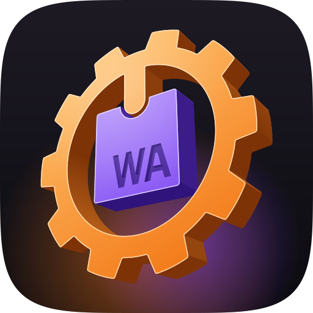

<p align="center">
  
</p>

<h1 align="center">CogWasm</h1>

<p align="center"><b>A Rust compiler, built from rustc, that runs as WebAssembly with no LLVM inside — Cranelift codegen, clif-to-wasm and the Wild linker. Compile Rust to Wasm anywhere a Wasm runtime runs, nothing to install.</b></p>

## Goal

CogWasm builds **rustc as a WebAssembly module that compiles Rust to
WebAssembly with no LLVM inside**. The whole compile pipeline is Rust:

```text
your code ──rustc.wasm──▶ Cranelift IR ──clif-to-wasm──▶ wasm objects ──Wild──▶ module.wasm
             (rustc_codegen_cranelift)
```

Anything that can run a wasm module (a WASI runtime such as Wasmtime, an
application that embeds one, or a browser) can then compile Rust on the spot:
no rustup, no cargo, no system linker, no C compiler and no LLVM to install.
That makes it practical to:

- ship a Rust compiler inside an application, for user scripts, plugins or
  live-reloaded extensions written in Rust;
- build sandboxed compile services and in-browser playgrounds;
- compile Rust on machines and platforms where installing a native toolchain
  isn't possible or wanted.

The priorities are: **pure Rust** (the shipped compiler contains no LLVM),
**fast edit-to-result** for small programs, and **output that runs in a
sandbox** with nothing but what the host chooses to provide.

## Status

Working end to end, still experimental. The build lives in
[`compiler/`](compiler/) and is built and
tested on every push by [CI](#ci). Differential tests also compare the pipeline
with LLVM rustc on every run: [`difftest`](difftest/README.md).
The permanent compile-time and execution suite lives in [`bench/`](bench/README.md):
it reports compiler start, compile phases, execution against LLVM `-O0`/`-O2`
and output size, and checks every result bit-for-bit before reporting a timing.

[](https://teamnodecraft.github.io/CogWasm/#benchmarks)

Each point is one CI commit: execution and module size relative to LLVM -O2
(lower is better), plus warm, incremental and precompiled compile time — click
for the interactive chart.

| | |
| --- | --- |
| Compiler | rustc nightly-2026-10-19 built for `wasm32-wasip1`, Cranelift as its only code generator, single-threaded |
| Runtime | Plain WASI preview 1 on Wasmtime 50; no threads support needed |
| Standard library | `core`, `alloc` and `compiler_builtins` for `wasm32-unknown-unknown`, built by `rustc.wasm` itself |
| No LLVM inside | Audited on every CI run: no LLVM imports, no `rustc_codegen_llvm` or `rustc_llvm` code |
| Compile time | About 79 ms to compile a small `no_std` program inside `rustc.wasm`, about 96 ms from edit to result with the compiler kept loaded (Apple M-series; about 2–3× that on a CI runner) |
| Incremental | One-line edits reuse rustc's incremental cache in the resident compiler: about 12–14% faster edit to result for 12–18% larger output; opt-in (`--incremental`), off by default |
| First load | 37.6 s to compile the 137 MiB `rustc.wasm`, 0.46 s from Wasmtime's cache, **18.7 ms** from a per-host precompiled `.cwasm` (282 MiB); the release bundle ships one per host |
| Output | A small module of about 18 KB for a typical program (46 KB median over the suite, down from 64 KB), with a growable heap |
| Performance suite | [`bench/run.sh --quick`](bench/README.md) in CI on every compiler change; the full suite is published from the `bench-results` release |

Known limits:

- LLVM is still used **once at build time** to compile rustc itself into
  `rustc.wasm`. Nothing that ships uses it; removing it means self-hosting.
- Cranelift favours compile speed: the suite's geomean is about 2.5× LLVM
  `-O2` execution (down from 3.5× before the memory fixes; `sha256` is 1.5×
  and `sort` 3.5×), and code that mostly calls its host runs at parity.
- Procedural macros can't run inside `rustc.wasm` yet, and there is no debug
  info.
- The first load of the 137 MB `rustc.wasm` compiles it to native code
  (about 38 s); later loads come from Wasmtime's cache in about 0.46 s, or in
  about 19 ms from a per-host `.cwasm` (282 MB) built by the release workflow.
  The `.cwasm` is tied to the exact Wasmtime version and engine configuration;
  a mismatch falls back to compiling the `.wasm`.

## How it works

- **[rustc](https://github.com/rust-lang/rust)** with the rustc-to-wasm patch
  series from
  [rust-playground-inbrowser](https://github.com/ryancbuckley/rust-playground-inbrowser)
  (built on bjorn3's work), plus small patches of our own: run the compiler on
  the calling thread, return `f128` through a pointer on wasm, support
  `memory.grow` / `memory.size`, address read-only constant aggregates in
  place, inline small constant memory copies with wasm bulk-memory, and fold
  constant addresses. Wild gets a patch to omit all-zero data segments.
- **[rustc_codegen_cranelift](https://github.com/rust-lang/rustc_codegen_cranelift)**
  lowers Rust to Cranelift IR.
- **[clif-to-wasm](https://github.com/ryancbuckley/clif-to-wasm)** turns
  Cranelift IR into relocatable wasm object files that follow the standard
  WebAssembly C ABI.
- **[Wild](https://github.com/wild-linker/wild)**, a linker written in Rust,
  links them; the host runs it because WASI has no way to start a process.

Every patch is kept small and written so it can go upstream. Revisions are
pinned in
[`docs/pipeline.md`](docs/pipeline.md).

## Future directions: threads

`rustc.wasm` currently runs **single-threaded**: the compiler and its code
generator run on the calling thread, so it needs only plain WASI preview 1 and
works on the latest Wasmtime. For small programs this costs little; parallel
code generation starts to matter for larger crates.

WebAssembly already has what multi-threaded code needs, but not a standard way
to start a thread outside the browser:

| Piece | Status (late 2026) |
| --- | --- |
| Atomics and shared memory (the core threads proposal) | Standardised and widely supported |
| Starting a thread | Not part of core wasm. Browsers use Web Workers; standalone runtimes had [wasi-threads](https://github.com/WebAssembly/wasi-threads) as a stopgap, which Wasmtime removed from version 47 on |
| [shared-everything-threads](https://github.com/WebAssembly/shared-everything-threads/blob/main/proposals/shared-everything-threads/Overview.md), the proper successor | A draft under active development; it adds component-model built-ins so standalone engines can create threads |
| Wasmtime support for shared-everything-threads | Not implemented yet ([wasmtime#9466](https://github.com/bytecodealliance/wasmtime/issues/9466)) |

There is no target date for shared-everything-threads, so the plan is staged:

1. **Now: stay single-threaded.** Simplest, most portable, and fast enough for
   small programs. This mode stays available whatever comes next.
2. **When parallel codegen pays off: host-provided threads.** Wasmtime still
   supports shared memory and atomics; only the wasi-threads crate was removed.
   The embedding host can provide a `thread-spawn` import itself: create another
   instance on the same shared memory, run it on an OS thread and call the
   module's thread entry point. This is what browsers do with Web Workers. It
   keeps us on the latest Wasmtime, and rustc's existing threading code works
   unchanged. Pinning an old Wasmtime that still ships wasi-threads (version 46)
   also works, but leaves the runtime behind, so it is not the plan.
3. **When it ships: shared-everything-threads.** Replace the host-provided
   import with the standard API once it is standardised and implemented in
   Wasmtime.

## Contributing

Contributions from people and AI agents are welcome. Start with
[`AGENTS.md`](AGENTS.md): the goals still to complete are in
[`agents/ROADMAP.md`](agents/ROADMAP.md), the conventions in
[`agents/GUIDELINES.md`](agents/GUIDELINES.md), and how we work with upstream
projects in [`CONTRIBUTING.md`](CONTRIBUTING.md).

## Credits

CogWasm continues [oligamiq/rust_wasm](https://github.com/oligamiq/rust_wasm)
(via [AlexMitchellMus/rust_wasm](https://github.com/AlexMitchellMus/rust_wasm)),
which built rustc **with** LLVM for WebAssembly; that build is kept below as
the legacy path. The pure-Rust compiler stands on bjorn3's rustc-to-wasm and
Cranelift work, Ryan Buckley's clif-to-wasm and in-browser playground, the Wild
linker and the Bytecode Alliance's Cranelift and Wasmtime.

Logo and artwork: [`artwork/cog-logo/`](artwork/cog-logo/ARTWORK.md). © 2026
AlexMitchellMus, all rights reserved; see that file for permitted use.

## CI

- [`cranelift_wasm.yml`](.github/workflows/cranelift_wasm.yml) is the primary
  path. It runs on pushes to `main` that touch `compiler/**`, `crates/**`,
  `guests/**`, `difftest/**`, `ci/**`, `release/**`, `bench/**`, `Cargo.toml`,
  `Cargo.lock` or the workflow itself, plus `workflow_dispatch`. It builds the pure-Rust `rustc.wasm`
  (`wasm32-wasip1`, Cranelift/cg_clif only), builds the plugin sysroot with
  `rustc.wasm` itself, runs plugin (c) end to end on Wasmtime 50.0.2 and
  asserts `eval(1,2,3,4) == 2.25`, checks A.2 (e)/(f) correctness, and audits
  `rustc.wasm` for LLVM imports/symbols. The full build log is published to the
  [`ci-logs` release](https://github.com/TeamNodeCraft/CogWasm/releases/tag/ci-logs);
  `rustc.wasm` and the pure sysroot are workflow artifacts kept for 7 days.
  The same logic runs locally:
  `ci/build-and-test.sh`. The first green run
  (2026-11-18) took 45m21s on a 4-core `ubuntu-latest`; sizes, disk/cache use
  and the macOS/Linux differences are recorded in
  [`docs/pipeline.md`](docs/pipeline.md#ci).
- [`rustc_llvm_with_lld.yml`](.github/workflows/rustc_llvm_with_lld.yml) builds
  the LLVM/LLD-based compiler and dist jobs. It is **manual only**
  (`workflow_dispatch`) and no longer runs on push.


## The LLVM-based build (legacy)

The original approach compiles rustc **with LLVM and LLD** to WebAssembly. It
is no longer built on push; its workflow can still be run by hand.

The LLVM path lives in [`legacy/llvm/`](legacy/llvm/README.md) and is kept for
manual builds. The A/B baselines in `difftest` and `bench` use the native LLVM
rustc from rustup, not this path.

### Upstream Sources
- **rustc_llvm**: [rust-lang/rust](https://github.com/rust-lang/rust) `1.99.1` plus the
  compiler patches in [`legacy/llvm/patches/rust-1.99.1/`](legacy/llvm/patches/rust-1.99.1/). There is no
  separate `rust` fork: CI checks out the upstream tag, applies the patch series
  with `git am`, then initializes submodules.
- **clang, wasm-ld, etc**: [YoWASP/clang](https://github.com/YoWASP/clang)

### Dependencies
- [toolchain-for-building-rustc](https://github.com/oligamiq/toolchain-for-building-rustc): Prebuilt toolchain for building rustc.

### Platform Support
This project targets Tier 1 and Tier 2 host platforms. See [Rust Platform Support](https://doc.rust-lang.org/nightly/rustc/platform-support.html) for details.

### Release Process

To prevent repository bloat, we no longer commit binaries to Git. Instead, we use **GitHub Actions Artifacts** and **GitHub Releases**.

#### Step 1: Build Artifacts
Generate the binaries by running the following workflows via the GitHub Actions UI (or `gh` CLI).

1. **Build LLVM**: Builds the Wasm versions of LLVM/Clang tools.
2. **rustc_llvm_with_lld**: Builds the Rust compiler for the supported host platforms.
   - Run this workflow for each `job` input: `install`, `dist-linux`, `dist-macos`, `dist-windows`.

**Verification**: After each job completes, verify that the artifacts are uploaded in the "Artifacts" section at the bottom of the run details page.

#### Step 2: Create Release
Once all builds (LLVM and Rust for each OS) are successful, create a release.

1. Run the **create release** workflow.
2. Provide the tag name (e.g., `v0.2.0`) in the `version` input.
3. **Automated Processes**:
   - Automatically downloads the latest artifacts from the most recent successful builds.
   - Packages them for distribution (`.tar.gz`, `.br`).
   - Uploads them directly to the **GitHub Releases** page.

#### Hosting and download URLs
- Assets from GitHub Releases are automatically deployed and hosted on both **Cloudflare Pages** and **GitHub Pages**.
- **Cloudflare Pages Base URL**: `https://rustwasm0.pages.dev/`
- **GitHub Pages Base URL**: `https://oligamiq.github.io/rust_wasm/`
- **Path Format**: `/<version>/<filename>` (where `<version>` is the tag name without the `-release` suffix).

**Download Examples (for `v3.0.0`)**:
- Linux dist: 
  - Cloudflare: `https://rustwasm0.pages.dev/v3.0.0/x86_64-unknown-linux-gnu.tar.gz`
  - GitHub Pages: `https://oligamiq.github.io/rust_wasm/v3.0.0/x86_64-unknown-linux-gnu.tar.gz`
- Rust source: 
  - Cloudflare: `https://rustwasm0.pages.dev/v3.0.0/rust-src.tar.gz`
  - GitHub Pages: `https://oligamiq.github.io/rust_wasm/v3.0.0/rust-src.tar.gz`
- Brotli compressed LLVM binaries: 
  - Cloudflare: `https://rustwasm0.pages.dev/v3.0.0/llvm_opt.wasm.br`
  - GitHub Pages: `https://oligamiq.github.io/rust_wasm/v3.0.0/llvm_opt.wasm.br`

*Note: On Cloudflare Pages, files larger than 20MB are automatically split (`.part00`, `.part01`...) to bypass file size limits. Use the included `split_manifest.json` (e.g., `https://rustwasm0.pages.dev/v3.0.0/split_manifest.json`) to restore the original files. GitHub Pages hosts the complete, undivided files.*

### About `rustc_unwind.wasm`

The `rustc_unwind.wasm` file indicates that the compiler itself was built with `panic=unwind`. It does not automatically make generated programs use unwinding. The panic strategy of generated programs is still controlled by the selected sysroot and `-C panic`.

For normal target programs, use:
- `rustc.wasm` or `rustc_unwind.wasm`
- `sysroot-abort`
- `-C panic=abort`

Using `-C panic=unwind` requires a separate unwind-enabled sysroot and runtime support for WebAssembly exception handling.

### Legacy cleanup
The following branches previously used to store binaries are now deprecated. After confirming that the new release process distributes files correctly, please delete these branches to reduce repository size:

- `rustc_llvm_with_lld-bins`
- `rustc_llvm_with_lld-bins-tier2-host`
- `rustc_llvm_with_lld-bins-tier2-host-windows`
- `rustc_llvm_with_lld-bins-tier2-host-mac`
- `llvm-tools`
- `gh-pages` (if used only for binary distribution)

## References
- [Miri issue #722](https://github.com/rust-lang/miri/issues/722)
- [LLVM Discourse RFC](https://discourse.llvm.org/t/rfc-building-llvm-for-webassembly/79073/37)
- [rubri](https://github.com/LyonSyonII/rubri)

## License

Unless otherwise noted, the original source code, build scripts, configuration
files, and documentation in this repository are licensed under either of

- [MIT License](LICENSE-MIT)
- [Apache License, Version 2.0](LICENSE-APACHE)

at your option.

The build scripts
(`legacy/llvm/toolchain-scripts/build-netbsd-toolchain.sh`,
`legacy/llvm/toolchain-scripts/build-solaris-toolchain.sh`,
`legacy/llvm/toolchain-scripts/crosstool-ng-build.sh`,
`legacy/llvm/toolchain-scripts/musl-toolchain.sh`, and
`legacy/llvm/toolchain-scripts/musl.sh`) and the
`legacy/llvm/toolchain-scripts/*.defconfig` files include code copied or adapted
from the
[Rust project's CI build infrastructure](https://github.com/rust-lang/rust/tree/46e8d20301cb4abe91ab0a4bea43bb085e1d4e4a/src/ci/docker).
Upstream copyrights are retained by the Rust contributors. Those portions remain
subject to Rust's [license terms and copyright notices](https://github.com/rust-lang/rust/blob/46e8d20301cb4abe91ab0a4bea43bb085e1d4e4a/COPYRIGHT).

Third-party code and distributed artifacts remain subject to their respective
licenses and copyright notices. The licenses of this repository do not relicense
those components. They include:

| Component | License |
| --- | --- |
| [Rust](https://github.com/rust-lang/rust) (rustc, the standard library, `rustc_codegen_cranelift`) | MIT OR Apache-2.0 |
| [Cranelift](https://github.com/bytecodealliance/wasmtime/tree/main/cranelift) and [Wasmtime](https://github.com/bytecodealliance/wasmtime) | Apache-2.0 WITH LLVM-exception |
| [clif-to-wasm](https://github.com/ryancbuckley/clif-to-wasm) | Apache-2.0 WITH LLVM-exception |
| [rust-playground-inbrowser](https://github.com/ryancbuckley/rust-playground-inbrowser) rustc-to-wasm patch series | Apache-2.0 |
| [Wild](https://github.com/wild-linker/wild) | MIT OR Apache-2.0 |
| [wasi-libc](https://github.com/WebAssembly/wasi-libc) (linked into wasm builds of `std`) | Apache-2.0 WITH LLVM-exception, MIT and others (see its LICENSE files) |
| [LLVM](https://github.com/llvm/llvm-project), Clang and LLD (the LLVM-based build under `legacy/llvm/patches/`; build-time only for `compiler/`) | Apache-2.0 WITH LLVM-exception |

The logo, icon and artwork in [`artwork/cog-logo/`](artwork/cog-logo/ARTWORK.md)
(the images, their generator script and their notes) are **not** covered by the
MIT or Apache-2.0 licence above. They are © 2026 AlexMitchellMus, all rights
reserved, and may only be used as described in
[`ARTWORK.md`](artwork/cog-logo/ARTWORK.md#copyright-and-permitted-use).

### Patch files

Patch files modify the project they apply to, and each one is licensed under
that project's license, not under this repository's MIT OR Apache-2.0 option.
This applies to `legacy/llvm/patches/**` and `compiler/patches/**`:

- `legacy/llvm/patches/rust-*/` and patches against `rustc_codegen_cranelift`: MIT OR Apache-2.0 (Rust).
- `legacy/llvm/patches/llvm-*/`: Apache-2.0 WITH LLVM-exception (LLVM).
- Patches against clif-to-wasm or Cranelift: Apache-2.0 WITH LLVM-exception.
- Patches against Wild: MIT OR Apache-2.0.

Each patch's header records that it was changed by the contributors to this
repository. Upstream patch series that the build scripts fetch at a pinned
revision (such as rust-playground-inbrowser's) are not copied into this
repository. If they are ever vendored here, their LICENSE and NOTICE files must
be copied with them.

Builds distributed from this repository (for example a `rustc.wasm` release)
must include the license texts and notices of every component inside them. A
modified build must not present itself as the official Rust compiler; describe
it as built from rustc.
